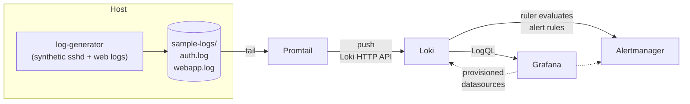

# log-monitoring-stack

A small Docker Compose stack for collecting, storing, searching and alerting
on logs in a home lab: **Loki** (storage + LogQL), **Promtail** (shipper),
**Grafana** (dashboards) and **Alertmanager** (receives alerts from Loki's
ruler).

I built this as a learning/portfolio project to understand the same log
pipeline pattern used in larger observability stacks, end to end - from a
log line on disk to a dashboard panel and an alert. It is sized and
configured for a single machine; it is not production-ready.

## Architecture



| Component | Role | Bound to |
|-----------|------|----------|
| Loki 3.6 | Store + query logs; evaluate alert rules | `127.0.0.1:3100` |
| Promtail 3.6 | Tail files, attach labels, push to Loki | (internal) |
| Grafana 13 | Dashboards and Explore | `127.0.0.1:3000` |
| Alertmanager 0.34 | Receive and group alerts from Loki's ruler | `127.0.0.1:9093` |
| log-generator | Writes synthetic sshd + JSON web logs | (writes files) |

> **Note on Promtail:** Grafana has deprecated Promtail in favor of
> [Grafana Alloy](https://grafana.com/docs/alloy/latest/), and Promtail is
> no longer published with Loki 3.7+ (3.6.x is its latest release line). I used it here because its config is simple
> to read for learning; migrating the shipper to Alloy is the first
> roadmap item.

Every published port is bound to loopback on purpose. Don't publish them on
`0.0.0.0` without authentication and TLS in front.

## Features

- **Provisioned Grafana**: Loki and Alertmanager datasources, plus a
  "Homelab - Security & Log Overview" dashboard, load automatically - no
  clicking through the UI after a rebuild.
- **Alert examples** (Loki ruler → Alertmanager):
  - `SSHFailedLoginSpike` - total failed passwords in 5 minutes
  - `SSHBruteForceSingleSource` - same, grouped by extracted `src_ip`
  - `SSHInvalidUserProbing` - attempts against non-existent usernames
  - `WebAppHighErrorRate` - share of HTTP 5xx responses
  - `LogSourceSilent` - Promtail stopped receiving sshd logs
- **Low-cardinality labels**: Promtail only labels with `job`, `host`,
  `event` and `level`. High-cardinality values (source IPs, usernames,
  URLs) stay in the line and are extracted at query time with LogQL.
- **Synthetic traffic**: a Python generator (stdlib only) writes realistic
  sshd syslog and JSON web logs, including occasional brute-force *bursts*
  so the alerts and dashboards have something to show.
- **7-day retention** on filesystem storage, with analytics disabled.

## Setup

### Requirements

- Docker Engine + Docker Compose v2
- ~1 GB free RAM and a few hundred MB of disk for lab volumes

### Steps

```bash
git clone https://github.com/jpennington-it/log-monitoring-stack.git
cd log-monitoring-stack

cp .env.example .env
# Edit .env: set GRAFANA_ADMIN_PASSWORD to something long, and on Linux set
# LAB_UID / LAB_GID to the output of `id -u` / `id -g` so the sample log
# files are owned by you.

docker compose up -d
docker compose ps
```

Open:

- Grafana → http://localhost:3000 (user from `.env`, default `admin`)
- Loki ready → http://localhost:3100/ready
- Alertmanager → http://localhost:9093

In Grafana: **Dashboards → Homelab → Homelab - Security & Log Overview**.
Within a minute of `up -d` you should see SSH events and HTTP status counts.
The generator emits a simulated brute-force burst at start-up and every 10
minutes, so `SSHBruteForceSingleSource` fires within about 2-3 minutes and
shows up in Alertmanager (http://localhost:9093) and in Grafana under
**Alerting → Alert rules / Alertmanager data source**. `SSHFailedLoginSpike`
fires a minute later but is *inhibited* in Alertmanager while the more
specific brute-force alert is active.

Useful commands:

```bash
docker compose logs -f promtail loki          # shipper / store
curl -s http://localhost:3100/ready                # "ready" once Loki is up (~30-60s)
curl -s http://localhost:3100/metrics | head
docker compose stop log-generator             # once you point Promtail at real logs
docker compose down -v                        # stop and wipe local volumes
```

### Pointing Promtail at real logs

1. Stop the generator: `docker compose stop log-generator`
2. In `docker-compose.yml`, uncomment the `/var/log:/var/log/host:ro` volume
   on Promtail (Linux hosts).
3. Uncomment the `host-syslog` scrape job in
   `promtail/promtail-config.yml`.
4. `docker compose up -d promtail`

Only ship logs from machines you own or are authorized to monitor.

## Configuration map

```
.
├── docker-compose.yml
├── .env.example
├── loki/
│   ├── loki-config.yml          # single-binary, filesystem, 7-day retention
│   └── rules/fake/alerts.yml    # ruler alert rules (tenant "fake")
├── promtail/promtail-config.yml # scrape jobs + pipeline stages
├── alertmanager/alertmanager.yml
├── grafana/
│   ├── provisioning/            # datasources + dashboard provider
│   └── dashboards/security-overview.json
├── generator/generate_logs.py
├── sample-logs/                 # auth.log / webapp.log land here
└── scripts/validate_configs.py  # offline YAML/JSON/compose checks
```

## Troubleshooting

| Symptom | Likely cause | What to check |
|---------|--------------|---------------|
| `compose` refuses to start Grafana | `.env` missing / password unset | `cp .env.example .env` and set `GRAFANA_ADMIN_PASSWORD` |
| Grafana has no Loki datasource | Provisioning path wrong | Logs: `docker compose logs grafana \| grep provision`; files under `grafana/provisioning/` |
| Dashboard panels empty | No data yet, or wrong time range | Confirm `sample-logs/*.log` are growing; Promtail logs show `tail routine: started`; try last 15 minutes |
| Promtail `permission denied` on a host log | Container user can't read the file | Check host file mode/ACLs; for lab use, keep shipping from `./sample-logs` |
| Alerts never fire | Thresholds vs. traffic, or ruler not loaded | `curl localhost:3100/loki/api/v1/rules` should list the groups; lower thresholds in `loki/rules/fake/alerts.yml` for testing |
| Grafana "Test" on the Alertmanager data source shows *Plugin unavailable* | That data source type has no health check in Grafana | Expected; alerts still list under Alerting. Confirm with `curl localhost:9093/api/v2/alerts` |
| Can't delete files in `sample-logs/` | Written by the container as root (older `.env` without `LAB_UID`) | `sudo rm sample-logs/*.log`, then set `LAB_UID`/`LAB_GID` in `.env` |
| Disk filling up under Docker | Volumes growing | Retention is 7 days; `docker compose down -v` wipes lab data |
| Port already in use | Something else on 3000/3100/9093 | Change the left-hand side of the port mapping, keep `127.0.0.1:` |

## Validating configs without Docker

```bash
python3 -m venv .venv && . .venv/bin/activate   # .venv is git-ignored
pip install pyyaml
python3 scripts/validate_configs.py      # YAML parse, dashboard UIDs, alert schema, bind mounts
docker compose config --quiet            # Compose interpolation + schema (needs .env)
```

I've also tested the full stack end to end with `docker compose up -d`
from a fresh clone: Grafana came up with both data sources and the
dashboard provisioned, every dashboard panel returned data, Loki ingested
both log streams, the brute-force alert fired into Alertmanager (with the
spike alert inhibited), and `docker compose down -v` cleaned everything up.

## What I learned

- Why label cardinality matters: putting a source IP on every log line as a
  Loki label would explode the index; extracting it with `| regexp` at query
  time keeps storage cheap and queries still useful.
- How Loki's ruler reuses the Prometheus alerting rule format and hands
  firings to Alertmanager, including an inhibit rule so a specific
  brute-force alert suppresses the generic spike.
- Grafana provisioning (datasources, dashboards, fixed UIDs) makes the
  stack rebuildable - `docker compose down -v && up -d` brings the same
  UI back with no manual clicks.
- Pipeline stages in Promtail (regex → timestamp → labels → template) are
  where most of the "make this log useful" work actually lives.

## Roadmap

- [ ] Replace Promtail with Grafana Alloy (same labels and pipeline logic)
- [ ] Optional TLS termination in front of Grafana (Caddy / Traefik)
- [ ] A second scrape job for Windows Event Logs via Promtail's Windows
      target, documented for a mixed lab
- [ ] Recording rules for commonly reused LogQL expressions
- [ ] A `make smoke-test` target that curls `/ready` and runs a sample query

## License

[MIT](LICENSE) © Joseph Pennington
